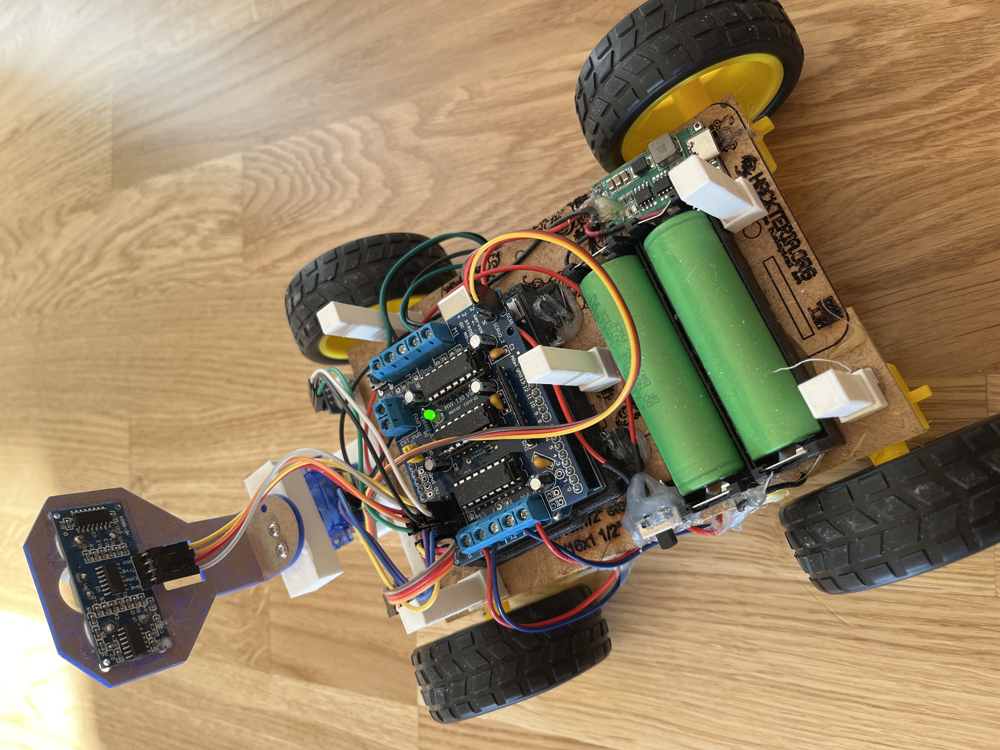

# Line Following & Obstacle Avoidance Robot

A four-wheel robot that follows a black line with three IR sensors and drives around obstacles it finds with an
ultrasonic sensor on a scanning servo. The logic is a non-blocking **finite state machine**: follow the line → reverse →
scan left and right → drive around the obstacle on the freer side → find the line again.

The repository holds two versions of the same robot:

| Version | Board | Motor driver | Extras | Code |
| :--- | :--- | :--- | :--- | :--- |
| **Uno** (original) | Arduino Uno | Adafruit Motor Shield (AFMotor) | – | [`Folowing_and_obstacle_avoidance.ino`](Folowing_and_obstacle_avoidance.ino) |
| **ESP32** | ESP32 | 2 × TB6612FNG | Wi-Fi: live telemetry, settings and remote control | [`ESP32/`](ESP32) |



---

## How it works

| State | What the robot does |
| :--- | :--- |
| `LINE_FOLLOW` | Drives along the line. Centre sensor only → straight; centre + side → gentle correction; only a side sensor → pivot. Line lost → keeps turning the way it last went. |
| `REVERSING` | An obstacle is closer than `OBSTACLE_THRESHOLD`: backs up for `REVERSE_TIME`. |
| `SCANNING` | Turns the servo left, then right, and measures the free distance on both sides. |
| `OBSTACLE_AVOID` | Drives around the obstacle on the side with more room (turn, forward, turn, forward, turn), then goes back to `LINE_FOLLOW`. If neither side has `MIN_CLEARANCE`, it reverses again. |

The ultrasonic distance is smoothed (exponential filter), and every state change has a short cooldown so the motors
never switch direction abruptly.

---

## Uno version

[`Folowing_and_obstacle_avoidance.ino`](Folowing_and_obstacle_avoidance.ino)

**Libraries** (Arduino Library Manager): `NewPing`, `Servo`, `AFMotor` (Adafruit Motor Shield V1).

| Component | Pin |
| :--- | :--- |
| IR left / centre / right | `A5` / `A4` / `A2` |
| Ultrasonic trigger / echo | `A1` / `A0` |
| Scanning servo | `10` |
| Motors (shield ports) | front-left `M3`, front-right `M2`, rear-left `M4`, rear-right `M1` |

| Setting | Value | Meaning |
| :--- | :--- | :--- |
| `BASE_SPEED` | 80 | speed on the line (0–255) |
| `PIVOT_SPEED` | 130 | speed for sharp turns |
| `LIGHT_ADJUST_SPEED` | 100 | speed for small corrections |
| `OBSTACLE_THRESHOLD` | 10 cm | closer than this = obstacle |
| `MIN_CLEARANCE` | 20 cm | a side needs this much room to drive around |
| `START_DELAY_TIME` | 3000 ms | wait after power-on before driving |

---

## ESP32 version

Same robot, with an ESP32 and two TB6612FNG motor drivers, connected to Wi-Fi.

**Libraries** (Arduino Library Manager): `ESP32Servo`, `NewPing`, `WebSockets` (Markus Sattler), `ArduinoJson`.
Board: *ESP32 Dev Module* (ESP32 boards package).

### Two sketches

| Sketch | What it is |
| :--- | :--- |
| [`ESP32/LineFollowing_ESP32`](ESP32/LineFollowing_ESP32) | The full line follower + obstacle avoider (the state machine above). Sends telemetry over a WebSocket on port 81 and takes settings and simple commands. |
| [`ESP32/WebUI_ESP32`](ESP32/WebUI_ESP32) | Remote control from the phone: the ESP32 serves a web page (`index.h`) with a joystick, mode buttons, speed / distance settings and live sensor readings. Its autonomous mode is simple: drive forward, back up and turn away from obstacles. |

### Before uploading

Put your Wi-Fi in the sketch:

```cpp
const char* ssid = "YOUR_WIFI_NAME";
const char* password = "YOUR_WIFI_PASSWORD";
```

- **LineFollowing_ESP32** waits until the Wi-Fi is connected before it starts, and prints its IP address on the
  Serial Monitor (115200 baud).
- **WebUI_ESP32** tries the Wi-Fi for 4 s. Without it, it opens its own hotspot **`ESP32-Robot-AP`** (password
  `12345678`, change it in the sketch). Then open **http://robo.local** (or the robot's IP) in the phone's browser.

### Pins

| Component | Pin |
| :--- | :--- |
| TB6612FNG standby (both drivers) | `23` |
| Driver 1 (left): PWMA / AIN1 / AIN2 | `25` / `26` / `27` |
| Driver 1 (left): PWMB / BIN1 / BIN2 | `4` / `16` / `17` |
| Driver 2 (right): PWMA / AIN1 / AIN2 | `32` / `33` / `21` |
| Driver 2 (right): PWMB / BIN1 / BIN2 | `19` / `18` / `22` |
| IR left / centre / right | `15` / `35` / `34` |
| Ultrasonic trigger / echo | `14` / `2` |
| Scanning servo | `13` |

### WebSocket messages (port 81)

The robot sends telemetry as JSON every 200 ms:

```json
{ "distance": 42, "irLeft": false, "irCenter": true, "irRight": false, "state": "Line Following" }
```

and accepts:

| Message | Sketch | Effect |
| :--- | :--- | :--- |
| `{"type":"settings","baseSpeed":140,"pivotSpeed":170,"obstacleThreshold":15,...}` | both | change speeds / distances while driving |
| `{"type":"toggleLine","enabled":false}` | LineFollowing | pause / resume line following |
| `{"type":"manualCmd","cmd":"forward"}` (`backward`, `stop`) | LineFollowing | simple manual driving |
| `{"type":"joystick","x":0.5,"y":-1.0}` | WebUI | tank-style driving from the joystick |

> The battery and temperature values in the telemetry are fixed placeholders, not measurements.


